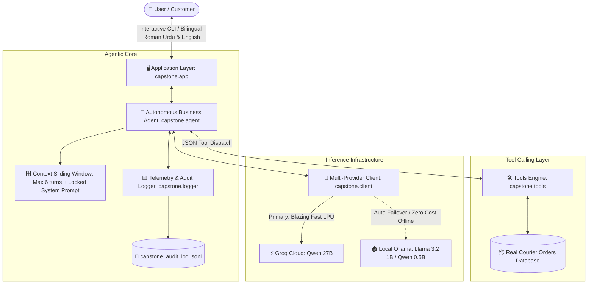

# 🌟 Multi-Provider AI Business Assistant
> **Enterprise-Grade Autonomous AI Assistant with Dual-Provider Inference (Groq + Ollama), Autonomous Function Calling, Live Cost Telemetry, Context Sliding Window & Automated Evals.**

[](https://www.python.org/downloads/)
[](https://opensource.org/licenses/MIT)
[](https://docs.pytest.org/)
[](https://groq.com/)

---

## 🏗️ System Architecture



---

## ✨ Key Production Features

1. **Dual-Provider Architecture (Zero Vendor Lock-in):**
   - **Cloud:** High-speed inference via **Groq Cloud LPUs** (`qwen/qwen3.8-27b`).
   - **Local:** 100% offline, private inference via **Local Ollama** (`llama3.2:1b`, `qwen2.5:0.5b`).
   - Unified interface based on the universal **OpenAI Chat Completions Specification**.

2. **Autonomous Tool / Function Calling:**
   - Real-time courier tracking lookup across major carriers (TCS Express, Leopards Courier).
   - Autonomous parameter extraction (`order_id`) and two-stage synthesis.

3. **Context Sliding Window Memory:**
   - Always locks Constitutional System Prompt at index 0.
   - Automatically prunes history to recent $N$ turns, preventing context overflow (`ContextWindowExceededError`) and eliminating linear cost accumulation.

4. **Live Telemetry & Financial Cost Metering:**
   - Real-time token computation (Input vs Output token tracking).
   - Real-time dollar ($) calculation per turn using official pricing rates ($0.59 / 1M in, $0.79 / 1M out).
   - Cumulative session financial audit summary upon exit.

5. **Automated Cloud-to-Local Failover (Resilience):**
   - Automatically catches Cloud network disconnects or API rate limits (`429`) and transparently shifts to Local Ollama with zero business logic disruption.

6. **Persistent Structured Audit Trail:**
   - Every single turn is automatically persisted into `capstone_audit_log.jsonl` with ISO timestamps, session ID, latency (ms), token metrics, and dollar cost for compliance and fine-tuning.

7. **Automated Pytest Regression Evals:**
   - Includes full test suite verifying configuration integrity, tool execution, telemetry math, sliding window pruning, and end-to-end factual policy adherence.

---

## 📁 Repository Structure

```text
├── capstone/
│   ├── __init__.py           # Package marker
│   ├── config.py             # Centralized settings, model catalogs, pricing, and system prompts
│   ├── tools.py              # Mock Database, Python functions & OpenAI-compatible Tool Schemas
│   ├── client.py             # Unified Provider Client (Groq + Ollama + Auto-Failover)
│   ├── logger.py             # Structured JSONL Audit Logger & Telemetry Cost Meter
│   ├── agent.py              # Core Agent: Function Calling loop + Sliding Window + Streaming
│   ├── app.py                # Interactive CLI application with live commands
│   └── test_capstone.py      # Automated Pytest Regression & Evals Suite
├── lessons/                  # Complete 10-Module curriculum documentation & progress trackers
├── .env.example              # Sample environment configuration template
├── .gitignore                # Production secrets & venv protection
├── pytest.ini                # Pytest configuration
└── README.md                 # Production portfolio documentation
```

---

## 🚀 Quickstart Guide

### 1. Prerequisites
- Python 3.11+
- [Ollama](https://ollama.com/) (for local offline inference)
- Free [Groq Cloud API Key](https://console.groq.com/)

### 2. Installation
```powershell
# Clone the repository
git clone https://github.com/your-username/ai-business-assistant.git
cd ai-business-assistant

# Create and activate virtual environment
python -m venv .venv
.\.venv\Scripts\activate

# Install dependencies
pip install -r requirements.txt
# (or: pip install openai groq python-dotenv pydantic pytest)
```

### 3. Configure Environment Variables
Copy `.env.example` to `.env` and add your Groq API key:
```env
GROQ_API_KEY=gsk_your_actual_key_here
```

### 4. Pull Local Model (Optional for Offline Inference)
```powershell
ollama pull llama3.2:1b
```

---

## 💻 Running the Application

Launch the interactive assistant:
```powershell
python -m capstone.app
```

### CLI Commands Available During Chat:
- `/stats` — Displays live session cumulative tokens and cost.
- `/switch` — Switches active model on the fly (e.g. from Groq to Ollama).
- `exit` — Gracefully exits and displays cumulative session summary.

---

## 🧪 Automated Testing

Execute the comprehensive regression test suite:
```powershell
pytest -v capstone/test_capstone.py
```

Expected output:
```text
============================== test session starts ==============================
collected 6 items

capstone/test_capstone.py::test_config_models_integrity PASSED              [ 16%]
capstone/test_capstone.py::test_tools_order_tracking_success PASSED         [ 33%]
capstone/test_capstone.py::test_tools_order_tracking_not_found PASSED       [ 50%]
capstone/test_capstone.py::test_telemetry_cost_math PASSED                  [ 66%]
capstone/test_capstone.py::test_sliding_window_preserves_system_prompt PASSED [ 83%]
capstone/test_capstone.py::test_end_to_end_agent_response PASSED            [100%]

=============================== 6 passed in 2.77s ===============================
```

---

## 👨‍💻 Author
**Saeed** — Software Developer & AI Engineer  
*Specialized in Flutter, Next.js, Python, and Production Autonomous AI Systems.*
